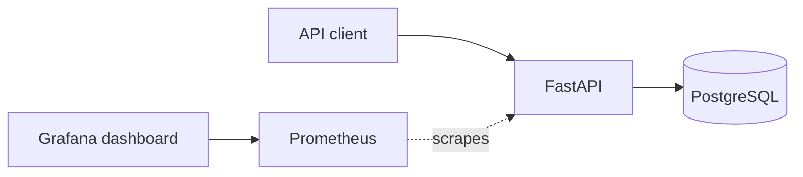

# ParcelOps

ParcelOps is a local-first shipment tracking service and DevOps portfolio capstone. It is designed to run on a laptop with Docker Compose; no AWS account or paid service is needed for the local version.

## Current scope

- FastAPI service for creating and tracking shipments
- PostgreSQL persistence
- Health and readiness endpoints for container orchestration
- Prometheus metrics endpoint
- Prometheus scraping and a provisioned Grafana dashboard
- Docker Compose development stack

Further increments will add image and dependency scanning, GitOps deployment, alerting, failure drills, and an optional AWS deployment with explicit cost controls.

## Run locally

Requirements: Docker Desktop (or Docker Engine) with the Compose plugin.

```sh
docker compose up --build
```

The API is available at <http://localhost:8000>; interactive API docs are at <http://localhost:8000/docs>. Prometheus is at <http://localhost:9090>, and Grafana is at <http://localhost:3000>.

For a stack that is already running, apply service additions or configuration changes with `docker compose up -d`. On first Grafana login, use `admin` for both username and password, then set a new local password when prompted. You can set your own initial password before starting the stack in PowerShell with `$env:GRAFANA_ADMIN_PASSWORD = 'your-local-password'`; do not reuse an important password. Grafana data persists in a Docker volume. Stop the stack with `docker compose down`. To also delete the local database and Grafana volumes, use `docker compose down --volumes` (this deletes saved shipments and Grafana state).

Grafana provisions the Prometheus datasource and the **ParcelOps Service Overview** dashboard from files in `monitoring/grafana`. Dashboard panels show request rate, 5xx error percentage, p95 latency, request rate by HTTP status, and request rate by API route. Generate API traffic to populate the panels. Provisioned dashboard changes should be made in the JSON file and committed to Git.

## Run automated checks

In a second terminal, from this folder, run:

```sh
docker compose --profile test run --build --rm tests
```

The test runner uses its own temporary in-memory SQLite database, so it does not alter the PostgreSQL demo data. A successful run prints `5 passed`.

## Continuous integration

GitHub Actions runs the same containerized checks on every push and pull request, and supports manual runs from the Actions tab. The workflow needs no cloud credentials or repository secrets. Add this folder to a GitHub repository and push it to activate the workflow.

## API

- `GET /health` — process liveness
- `GET /ready` — database connectivity
- `GET /metrics` — Prometheus metrics
- `POST /shipments` — create a shipment
- `GET /shipments` — list shipments
- `GET /shipments/{tracking_number}` — fetch one shipment
- `PATCH /shipments/{tracking_number}/status` — advance its status

Shipment statuses: `created`, `picked_up`, `in_transit`, `out_for_delivery`, `delivered`, and `exception`.

## Architecture



## Cost and safety

The local stack uses open-source software in containers and creates no cloud resources. It binds service ports to localhost. The database volume persists until explicitly removed. Before any future AWS deployment, review the current account plan, service availability, quotas, and pricing; the cloud version will have a teardown procedure and must not be assumed bill-free.
